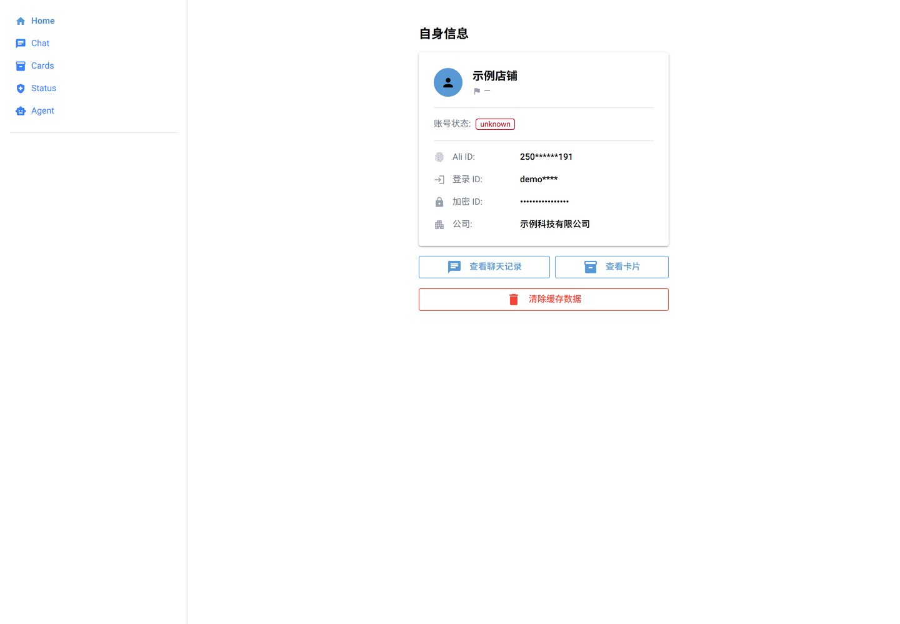
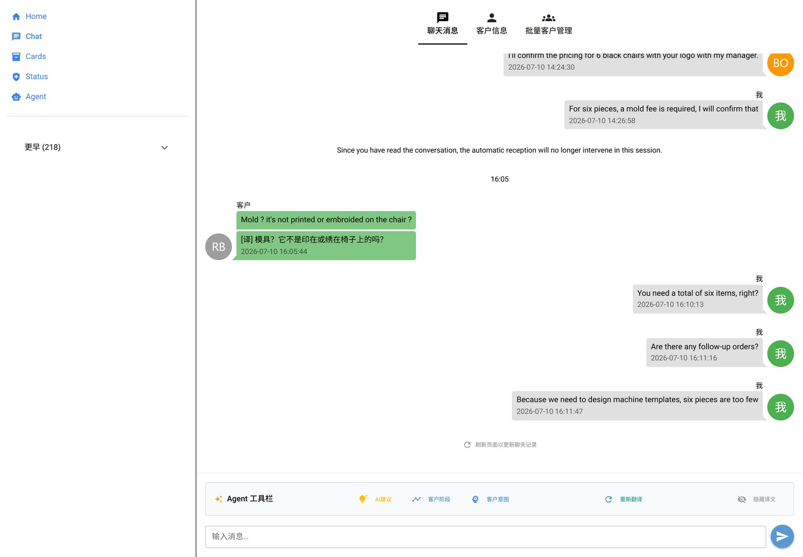
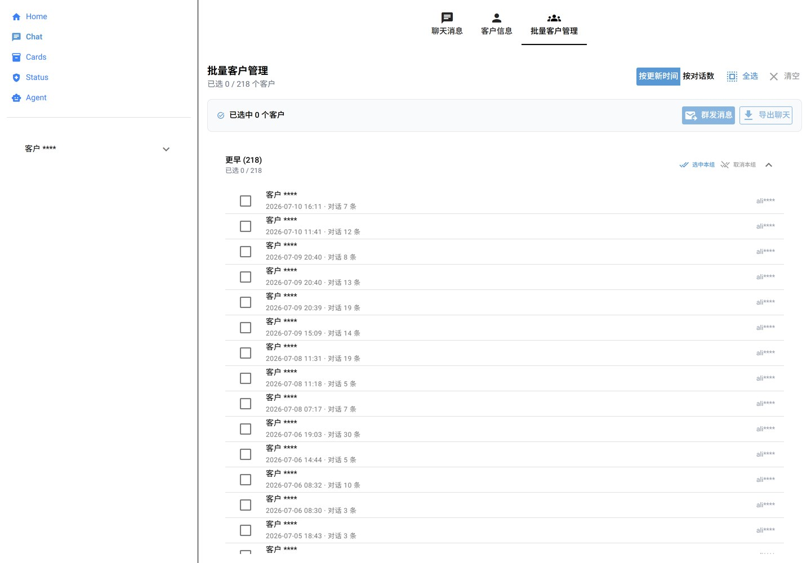
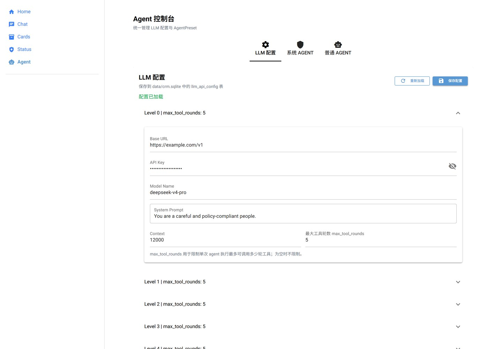

# MaaAlibabaSupplier

阿里卖家（Alibaba Supplier）智能客服与自动化助手。

项目将 **MITM 数据采集**、**本地 CRM**、**LLM Agent** 与 **MaaFramework 图像识别自动化** 组合成一个本地工作台：自动归档阿里国际站的客户会话，翻译买家消息，生成回复建议与客户分析，并在可确认的前提下代操作客户端完成消息发送。

> 本项目由 [MaaFramework](https://github.com/MaaXYZ/MaaFramework) 驱动 GUI 自动化能力，Web 界面基于 [NiceGUI](https://nicegui.io/)。

## 界面预览

| 自身信息 | 聊天工作台 |
| --- | --- |
|  |  |

| 批量客户管理 | Agent / LLM 配置 |
| --- | --- |
|  |  |

> 截图中的账号、客户与密钥信息均已脱敏。

## 功能特性

- **本地 CRM**：通过 Yak MITM 拦截阿里卖家客户端接口，解析登录账号、客户资料、会话、商品/询盘卡片；解密本地加密 IM 数据库，统一归并写入 SQLModel + SQLite，多平台标识（`ali_id` / `login_id` / `encrypt_account_id` 等）自动合并到同一客户。
- **聊天工作台**：会话分组与检索、消息流渲染、未读/待回复筛选、客户信息侧栏、商品/询盘/通用卡片展示，以及批量客户管理（全选、分组选择、导出聊天记录）。
- **AI 客服能力**：对接 OpenAI 兼容接口，提供买家消息多语言翻译、AI 回复建议、客户意图分析、客户所处阶段分析；支持多级 LLM 参数、系统 Agent 与自定义 AgentPreset、工具调用轮次控制。
- **RPA 自动化**：基于 MaaFramework 模板匹配与任务流水线，自动跳转指定联系人、写入或粘贴文本并发送消息，配合后台任务队列完成批量触达。
- **运行支撑**：统一编排 MaaFW 子进程、Yak MITM 代理、Python 接收器与 NiceGUI Web 服务，提供系统状态页与 SMTP 邮件通知。

## 技术栈

| 层次 | 技术 |
| --- | --- |
| 语言 | Python 3.10+ |
| Web / UI | NiceGUI、Quasar |
| GUI 自动化 | MaaFramework（图像识别、Pipeline、Custom Action/Recognition） |
| 数据采集 | Yak MITM、HTTP/JSON 解析、SQLite 加密库解密 |
| 数据存储 | SQLite、SQLModel / SQLAlchemy |
| AI | OpenAI 兼容 API、工具调用、AgentPreset |

## 快速开始

### 环境要求

- Windows 10/11
- Python 3.10 及以上（推荐 3.12）
- 已安装并登录阿里卖家客户端
- [Yak](https://yaklang.com/) CLI（用于本地 MITM 代理）
- [MaaFramework](https://github.com/MaaXYZ/MaaFramework/releases) win-x64 运行时

### 安装

```bash
git clone https://github.com/EgooAI/MaaAlibabaSupplier.git
cd MaaAlibabaSupplier

# 1. Python 依赖
python -m venv .venv
.venv\Scripts\activate
pip install -r app/requirements.txt

# 2. MaaFramework 运行时
#    将 MaaFramework win-x64 压缩包解压到 deps/，然后执行：
python tools/install.py

# 3. 环境变量
copy .env.example .env
#    按需修改 ALIBABA_DATA_DIR、MAAFW_EXECUTABLE、YAK_EXECUTABLE 等
```

### 启动

```bash
python app/main.py
```

启动后将依次拉起 MaaFW、MITM 接收器、Yak MITM 代理与 Web 服务，浏览器访问 <http://127.0.0.1:8787>。

仅调试 Web 界面时，可跳过 MaaFW 与 Yak，直接启动 NiceGUI：

```bash
python -c "from app.web.server import run; run()"
```

### 配置说明

完整变量见 [.env.example](.env.example)，常用的几项：

| 变量 | 说明 |
| --- | --- |
| `ALIBABA_DATA_DIR` | 阿里卖家客户端数据目录（含 `{ali_id}@icbu/database/im.sqlite`） |
| `MAAFW_EXECUTABLE` | `MaaPiCli.exe` 路径 |
| `MAAFW_WORKDIR` | MaaFW 工作目录，默认 `./install` |
| `MITM_PROXY_PORT` | Yak MITM 监听端口，默认 `8084` |
| `MITM_RECEIVER_PORT` | Python 接收器端口，默认 `8085` |
| `MAA_WEB_PORT` | Web UI 端口，默认 `8787` |
| `SYSTEM_PROMPT` | 追加到所有 LLM 请求的全局系统提示词 |

LLM 的 Base URL、API Key 与模型名在 Web 端 **Agent → LLM 配置** 中维护，保存到本地 `data/crm.sqlite`。

## 项目结构

```text
app/
  main.py         # 启动入口：MaaFW / MITM / Web 编排
  shared/         # 业务层：backend、agent、crm、mitm、utils
  crm_sdk/        # 可独立使用的本地 CRM SDK（SQLModel + SQLite）
  web/            # NiceGUI 页面与组件
  mitm/           # MITM 接收器
  agent/          # Maa Custom Action / Recognition
assets/           # MaaFramework 资源：image / pipeline / model
yak_mitm.yak      # Yak MITM 代理脚本
```

更细的模块说明见 [AGENTS.md](AGENTS.md)、[app/README.md](app/README.md) 与 [assets/README.md](assets/README.md)。

## 数据与隐私

- 客户、会话、消息与译文均保存在本地 SQLite（`data/crm.sqlite`、`data/pools.db`），不会上传到项目方服务器。
- MITM 代理与接收器只监听 `127.0.0.1`。
- 除用户自行配置的 LLM 接口外，程序不向外部服务发送业务数据。

## 许可证

[MIT](LICENSE)
